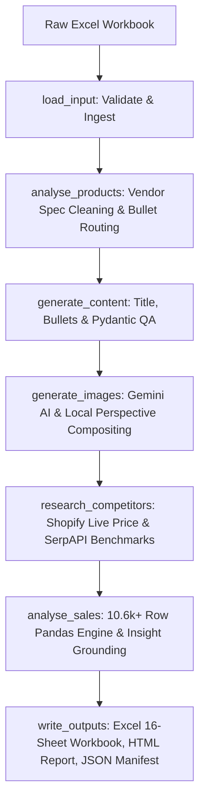

<div align="center">
  <h1 style="font-size: 2.6em; font-weight: 800; margin-bottom: 10px;">🚀 Autonomous E-Commerce Catalog & Sales Intelligence Agent</h1>
  <p style="font-size: 1.15em; color: #555; max-width: 820px; line-height: 1.6;">
    An enterprise-grade, multi-model <b>LangGraph</b> autonomous agent that transforms raw, messy vendor and sales workbooks into production-ready marketplace listings, perspective lifestyle scenes, live competitor pricing benchmarks, and rigorous sales analytics.
  </p>
  <p style="font-size: 1.05em; color: #777;">
    Built with 🖤 by <b><a href="https://github.com/DeveloperAnuragsrivastav">Anurag Srivastav</a></b>
  </p>

  <p align="center">
    <a href="https://github.com/DeveloperAnuragsrivastav/Autonomous-E-Commerce-Catalog-Sales-Intelligence-Agent/stargazers">
      
    </a>
    <a href="https://github.com/DeveloperAnuragsrivastav/Autonomous-E-Commerce-Catalog-Sales-Intelligence-Agent/network/members">
      
    </a>
    <a href="https://github.com/DeveloperAnuragsrivastav/Autonomous-E-Commerce-Catalog-Sales-Intelligence-Agent/issues">
      
    </a>
    <a href="https://opensource.org/licenses/MIT">
      
    </a>
  </p>

  <p align="center">
    
    
    
    
    
  </p>
</div>

<br/>

> 💡 **Why I built this:** E-commerce catalog creation and multi-channel sales auditing are notoriously fragmented, slow, and error-prone. Raw vendor feeds arrive riddled with inconsistent bullets, missing dimensions, and chaotic formatting, while merchandising teams waste days hand-copying attributes, staging lifestyle photos, scraping competitor pricing, and reconciling thousands of sales lines. I engineered this autonomous system from the ground up as a zero-human-handoff pipeline: drop in a raw multi-sheet Excel file, and within minutes receive fully QA-verified product listings, room-perspective lifestyle images, live competitor intelligence from Google Shopping, and audit-proof sales analytics — with zero hallucinated data and a modern web operations console. — *Anurag Srivastav*

---

## ⚡ The Ultimate Feature Stack

- 🧠 **LangGraph Autonomous State Machine**: 7-stage deterministic Directed Acyclic Graph (DAG) executing `load_input` → `analyse_products` → `generate_content` → `generate_images` → `research_competitors` → `analyse_sales` → `write_outputs`. Every step operates under isolated boundaries with hard deadlines and per-SKU fault containment.
- 🎯 **Fact-Grounded Copywriting & Pydantic QA**: Facts (specs, dimensions, materials, assembly, cartons, prices) are computed purely through deterministic Python & pandas algorithms. The LLMs (Gemini / Groq) only synthesize language. Every generated number, claim, and dimension is verified against ground-truth facts with automatic iterative self-correction loops.
- 🎨 **Adaptive Dual-Engine Lifestyle Studio**:
  - **Gemini AI Editing**: Generative room editing blending original product photography into photorealistic room scenes.
  - **Local Zero-Cost Room Compositor**: Fully offline and free. Leverages `rembg` background removal and renders the item in perspective at its **true physical dimensions** (e.g. 71" TV stand vs 41" recliner) with realistic directional lighting, contact shadows, flooring, and wall art. Product pixels are never altered, maintaining 100% product fidelity.
- 🛍️ **Live Competitor Intelligence & Shopify Pricing**: Real-time SKU pricing looked up directly against the live `benzara.com` Shopify endpoint. Automatically clusters representative models, executes live Google Shopping US searches via SerpAPI, eliminates noise, and builds a grounded competitor positioning matrix (Value / At Market / Premium).
- 📈 **Audited Multi-Channel Sales Analytics**: Deep statistical parsing across 10,692+ transaction lines. Deterministic order classification (Processed sales vs Cancelled vs Pending pipeline value vs Zero-value replacements), channel fee & volume share, unmapped carrier identification, and velocity grouping (Top, Low-moving, Non-moving, and Stalled SKUs).
- 💻 **Production-Grade Dual-Role Web Console**: Built with FastAPI and a modern operations UI. Features an **Admin** panel (masked server-side key management, quota-free API connectivity test buttons, custom model chains) and an **Operator** dashboard (drag-and-drop workbook upload, live 7-step progress timeline, real-time log streaming, and downloadable deliverables).
- 🛡️ **Zero-Failure Architecture & Multi-Model Cascade**: Built with resilient exponential backoff, persistent SQLite/disk caching (`agent/cache.py`), parallel S3 photo downloads, and automated failover: `gemini-3.5-flash` → `gemini-3.5-flash-lite` → `gemini-2.5-flash` → Groq `openai/gpt-oss-120b`.

---

## 🚀 Running Locally (Mac / Windows / Linux)

### Prerequisites

- **Python 3.12+**
- **Google AI Studio API Key** (Free tier supported for text; Gemini image editing requires billing)
- *(Optional)* **Groq API Key** (Instant fallback if Gemini encounters rate limits or daily quotas)
- *(Optional)* **SerpAPI Key** (Live Google Shopping competitor queries; 250 free monthly searches)

---

### Zero-to-Live Installation

1. **Clone the repository:**
   ```bash
   git clone https://github.com/DeveloperAnuragsrivastav/Autonomous-E-Commerce-Catalog-Sales-Intelligence-Agent.git
   cd Autonomous-E-Commerce-Catalog-Sales-Intelligence-Agent
   ```

2. **Create and activate a virtual environment:**
   ```bash
   python3.12 -m venv .venv
   source .venv/bin/activate       # On Windows: .venv\Scripts\activate
   ```

3. **Install the dependencies:**
   ```bash
   pip install -r requirements.txt
   ```

4. **Configure environment keys:**
   ```bash
   cp .env.example .env
   ```
   *Edit `.env` and configure your API keys:*
   ```env
   GOOGLE_API_KEY=your_google_ai_studio_key_here
   GROQ_API_KEY=your_groq_api_key_here
   SERPAPI_API_KEY=your_serpapi_key_here
   ```

5. **Run the Autonomous Agent Pipeline:**

   **Option A — Command Line Interface (CLI):**
   ```bash
   python main.py --input data/test_data.xlsx
   ```

   **Option B — Interactive Web Console (FastAPI UI):**
   ```bash
   python app.py
   ```
   *Open `http://127.0.0.1:8000` in your browser.*

---

### CLI Flags & Tuning Options

| Flag | Description | Default |
|---|---|---|
| `--input <path>` | Path to the vendor + sales workbook (`.xlsx`) | Required |
| `--skus <list>` | Comma-separated list of SKUs to process (e.g. `BM349936,BM349940`) | All SKUs |
| `--image-provider <mode>` | `auto` (Gemini with composite fallback), `gemini`, or `composite` | `auto` |
| `--image-limit <N>` | Restrict image generation to the first *N* SKUs for quota control | All SKUs |
| `--competitor-limit <N>` | Limit competitor search to the first *N* representative models | All models |
| `--competitor-skus <list>` | Run competitor analysis only on specific SKUs | All models |
| `--skip-images` | Bypass image generation (all other steps still execute) | `False` |
| `--skip-competitors` | Bypass competitor benchmarking | `False` |
| `--no-cache` | Invalidate disk caches and force fresh API/scraping calls | Uses cache |

*Exit codes: `0` = All steps completed successfully, `1` = Unreadable input/schema error, `2` = Finished with a non-fatal step warning.*

---

## 💻 The Interactive Web Console (FastAPI Dashboard)

Run `python app.py` to start the operations console.

```
       ┌─────────────────────────────────────────────────────────────┐
       │                   CATALOG AGENT CONSOLE                     │
       ├─────────────────────────────────────────────────────────────┤
       │  [Admin] Keys, Models, Settings  │  [Operator] Runs & Docs  │
       ├─────────────────────────────────────────────────────────────┤
       │  ► Live 7-Stage Pipeline Timeline [● Load ● Clean ● Content] │
       │  ► Real-time Console Log Stream (SSE / WebSocket)           │
       │  ► Product Listing Table with Live QA Status Badges         │
       │  ► Visual Image Gallery (Source vs Perspective Staging)     │
       │  ► Competitor Matrix & Price Positioning Graph              │
       │  ► Interactive Sales Performance & Channel Analytics        │
       └─────────────────────────────────────────────────────────────┘
```

- **Dual Role-Based Access Control**:
  - **Admin**: Manages API credentials (securely masked, stored server-side with instant, quota-free connectivity test endpoints), overrides model cascade chains, and adjusts defaults.
  - **Operator**: Uploads workbooks, configures SKU subsets, triggers runs, monitors live step counters (e.g., *Generate content 14/25*), and downloads final output packages.
  - *Credentials*: Set `CONSOLE_ADMIN_USER`/`PASSWORD` and `CONSOLE_OPERATOR_USER`/`PASSWORD` in `.env`. If omitted, strong random credentials are automatically generated on first launch and preserved in `instance/credentials.json`.
- **Pre-Loaded Exploration**: On first boot, the console automatically imports previous run artifacts from `output/`, allowing full inspection of listings, charts, and images before spending any API quota.
- **Enterprise Security**: Cookie sessions signed with cryptographic secrets, CSRF token validation on every form submission, and brute-force login throttling.

---

## 🧬 Pipeline Architecture & Data Flow

The agent implements a structured LangGraph `StateGraph` state machine ensuring complete separation of concerns and immutable data provenance:



### Modular Repository Layout

```
├── main.py                     # CLI entrypoint & argument parser
├── app.py                      # FastAPI Web Console entrypoint
├── agent/                      # Autonomous agent core package
│   ├── graph.py                # LangGraph StateGraph pipeline & node runners
│   ├── config.py               # Centralized configuration & environment loader
│   ├── ingest.py               # Workbook loading & schema validation
│   ├── vendor.py               # Bullet routing & deterministic spec normalization
│   ├── sales_clean.py          # Sales transaction cleaning & order categorization
│   ├── content.py              # LLM copywriter & strict multi-rule QA validator
│   ├── images.py               # Gemini room editor & metric perspective compositor
│   ├── pricing.py              # Live Shopify storefront pricing lookup (benzara.com)
│   ├── competitors.py          # SerpAPI Google Shopping search & benchmark engine
│   ├── sales_analysis.py       # Pandas metrics calculation & grounded business insights
│   ├── grounding.py            # Strict numerical verification & hallucination guard
│   ├── llm.py                  # Structured LLM client: model cascade, retries, caching
│   ├── cache.py                # File & SQLite caching engine for LLM & search results
│   ├── models.py               # Pydantic data schemas & state models
│   ├── outputs.py              # Master 16-sheet Excel report builder
│   └── report_html.py          # Interactive standalone HTML report generator
├── webapp/                     # Modern Web Console application
│   ├── app.py                  # FastAPI server routes, middleware & auth
│   ├── runs.py                 # Asynchronous background run manager & worker
│   ├── store.py                # Server-side encrypted settings & run persistence
│   ├── static/                 # Curated CSS tokens & responsive JavaScript
│   └── templates/              # Jinja2 dashboard templates
├── data/                       # Input storage (test_data.xlsx)
├── images/                     # Generated lifestyle scenes (<SKU>.jpg + metadata)
├── output/                     # Production deliverables (Excel, HTML, JSON)
└── tests/                      # Pytest automated offline test suite
```

---

## 🛡️ Data Intelligence & Edge Cases Handled

The pipeline is engineered to ingest raw, unstandardized business feeds without requiring any manual data pre-processing:

### 1. Vendor Data Engineering (25 Furniture SKUs)
- **Dynamic Bullet Routing**: Bullets vary from 12 to 18 rows and mix cross-sells, assembly notes, and dimensions. The pipeline automatically extracts and routes them:
  - *"Check out our Jasi collection"* → **Collection metadata**
  - *"Modern, contemporary style"* → **Style tag**
  - *"Supports 300lbs"* → **Weight Capacity**
  - *"41L x 37W x 41H"* → **Normalized Dimensions** (L × W × H)
- **Conflict Resolution**: SKUs `BM349958` and `BM349959` specify `Assembly Required = No`, yet their bullet copy describes manual placement of decorative logs. The system preserves the raw boolean for marketplace attributes while generating explicit setup instructions in the copy to avoid buyer disputes.
- **Carton Multi-Pack Splitting**: Dynamic column discovery maps multi-box shipments (e.g. chaise sectional shipping across 2 boxes, 3-piece table set across 3 boxes) into structured carton records.

### 2. Sales Ledger Auditing (10,692 Transaction Lines)
- **Zero SKU Overlap Handled**: The sales dataset represents historical inventory with zero SKU overlap with the new 25 vendor items. Handled gracefully as distinct analytical workflows.
- **Rigorous Order Classification**:
  - `Processed`: Counted as finalized revenue.
  - `OJ Shipping`: 447 lines shipped via FedEx (unclassified in the raw brief) correctly identified as fulfilled/in-transit and credited to net sales.
  - `Cancelled`: 452 lines excluded from revenue; 94 previously zeroed lines isolated to track true gross lost demand.
  - `Pending`: 22 lines isolated and reported as forward pipeline value.
  - `Zero-Value Replacements`: 36 processed lines at $0.00 isolated as warranty/sample shipments.
- **Temporal Normalization**: Transactions span July 2 to September 1, 2025. Because September contains only a single business day, it is included in cumulative totals but excluded from month-over-month growth calculations to eliminate statistical distortion.

---

## 📦 Master Deliverables & Artifact Matrix

Every run produces an audit-ready suite of deliverables saved directly to `output/` and `runs/<id>/`:

| Deliverable | Format | Contents & Capabilities |
|---|---|---|
| `catalog_agent_results.xlsx` | **Excel Workbook** | **16 formatted sheets**: Content, Competitors, Competitor Insights, Our Prices, Sales Summary, Sales Insights, Monthly Performance, Top SKUs (Revenue & Units), Low-moving SKUs, Non-moving SKUs, Stalled SKUs, Channel Analysis, Fulfillment Route, Carrier Share, Excluded Lines, Data Quality Audit, and Run Log. |
| `report.html` | **HTML Document** | Standalone visual report displaying full listing copy side-by-side with generated lifestyle images, competitor comparisons, and sales charts. |
| `images/<SKU>.jpg` | **JPEG Image** | High-resolution lifestyle scene rendered per SKU, accompanied by `<SKU>.json` logging provider provenance and perspective metadata. |
| `data_quality.md` | **Markdown Document** | Comprehensive log of every detected data anomaly, cleaning action, and mitigation rationale. |
| `content.json` | **JSON** | Clean, machine-readable catalog listings ready for direct Shopify, Amazon, or ERP import. |
| `competitors.json` | **JSON** | Complete competitive intelligence dataset with real marketplace URLs and variance metrics. |
| `sales_analysis.json` | **JSON** | Structured sales totals, velocity distributions, and grounded analytical summaries. |
| `run_manifest.json` | **JSON** | Audit trail recording input checksums, duration timestamps, model provenance, and execution status. |

---

## 🧪 Automated Testing & Offline Validation

The repository includes a comprehensive test suite that runs completely offline in seconds without incurring external API costs:

```bash
pytest
```

The tests validate:
- **Bullet Routing & Attribute Normalization**: Ensures dimensional parsing, material cleaning, and carton mapping execute deterministically.
- **Pydantic Content QA Rules**: Verifies that titles missing required attributes, unsupported warranty claims, or invented numbers trigger automatic rejection.
- **Grounding Verifier**: Confirms that mathematical and statistical claims generated in LLM insights are strictly grounded against source facts.
- **Sales Engine Integrity**: Validates status filtering, cancelled line exclusions, and SKU velocity groupings.

---

## 🤝 Support the Project

If this autonomous agent saves you time or inspires your AI engineering workflows, **give this repository a ⭐️ Star** at the top right of the page! It helps support ongoing open-source engineering for the community.

**Created with 🖤 by [Anurag Srivastav](https://github.com/DeveloperAnuragsrivastav)** 🚀

---

## 📜 License

This project is licensed under the [MIT License](LICENSE). Feel free to fork, customize, and build commercial agentic systems with it!
